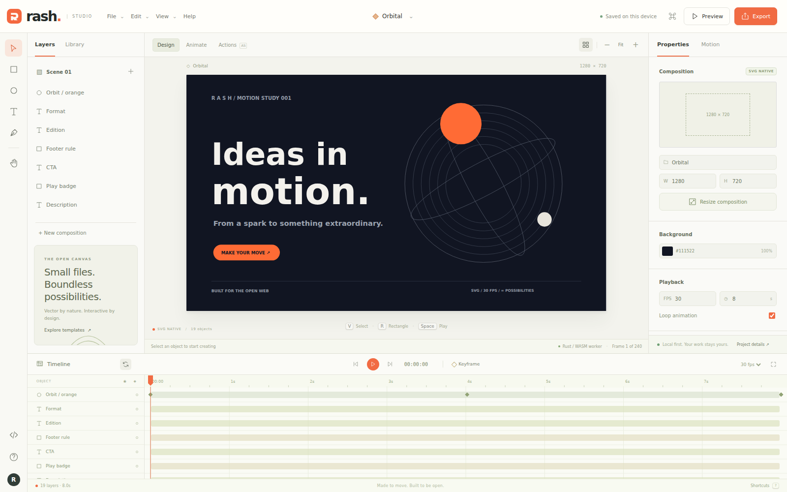

# Rash Studio

**Ideas in motion. Built for the open web.**



[Open the studio](https://ruvnet.github.io/Rash/) · [Compatibility](docs/compatibility.md) · [Architecture](docs/adr/001-svg-scene-and-worker-runtime.md) · [Security](docs/security.md)

Rash is an open source SVG animation studio with a Rust/WebAssembly scripting runtime, a visual timeline, and portable JavaScript embeds. It brings the stage, layers, tools, properties and frame based workflow of classic Flash into a responsive browser editor.

**Status: experimental v0.2.0.** Native Rash scripting implements a documented ActionScript inspired subset. It is **not complete ActionScript or Flash API compatibility**. Existing SWFs use a separate, optional Ruffle Rust/WASM compatibility player, with upstream compatibility limits. Source `.as` is not compiled to SWF. See the [compatibility matrix](docs/compatibility.md) and [UI acceptance audit](docs/ui-acceptance.md).

## Create and publish

1. Open [Rash Studio](https://ruvnet.github.io/Rash/).
2. Pick a template or create a composition in web, social, story, banner, HD, A4 or classic Flash dimensions.
3. Draw vectors, edit text, move objects, change their properties, and add timeline keyframes.
4. Preview the animation or run a bounded script in the Actions editor.
5. Export the project or copy an embed. Local autosave stays in your browser; download project JSON for backup.

| Capability | Implementation |
| :--- | :--- |
| Authoring | SVG stage, 2D vectors and Three.js box/sphere/torus/pyramid layers, inspector, layers, history, zoom |
| Animation | Editable motion presets, stagger, custom Bezier graph, bounce/elastic easing, 3D rotation, blur, glow, blend modes |
| Templates | Beyond 3D motion, orbital product story, launch, social story, kinetic typography, collector game, blank |
| Native scripts | Rust parser/interpreter in a dedicated worker; typed variables, arithmetic, conditions, loops, trace, scene properties, timeline controls |
| Legacy content | Isolated, optional self hosted Ruffle SWF player; no universal compatibility claim |
| Search | Lazy loaded real RuVector WASM, deterministic lexical feature vectors, explicit JavaScript fallback |
| Resources | Allowlisted local `rash://project/current`, `rash://node/ID`, `rash://template/orbit`, `rash://help/welcome` |
| Exports | Animated SVG, GIF, PNG, raster PDF, self contained animated HTML, project JSON, browser supported MP4 |
| Embedding | Independent `<rash-player>` instances, shadow DOM styles, responsive layout, controls, reduced motion |
| Developer tools | Claude plugin manifest, marketplace, author/verify skills, MetaHarness evidence script |

GIF is capped at 640 pixels and 120 sampled frames. MP4 is a real time browser recording, capped at 1920 pixels and 60 seconds; unsupported browsers report an explicit error. PDF exports frame zero as a raster image. These limits keep the static application bounded and honest.

### 3D and motion design

Open **3D** to add a box, sphere, torus or pyramid. Use **Scene camera** to adjust perspective and orbit. The inspector exposes X/Y rotation, depth, wireframe, blur, glow and blending. In **Motion**, apply Fade, Rise, Pop, 3D revolution, Float or Focus reveal, then edit the generated keys and easing curves. Existing timing is retained when a preset shares a keyframe with another property.

Start with the **Beyond / 3D motion** template for an animated composition. On phones, **More → 3D objects and camera** provides the same controls. Three.js geometry is projected into SVG; editor, embeds and exports share that renderer. The pinned Three.js module adds 25.3 KB gzip.

These are motion design tools inspired by After Effects, with no AEP import, expressions, masks, nested compositions or shared depth buffer between objects. Animated 3D SVG samples geometry and can be large: the eight second Beyond template exports approximately 3.45 MB. Limits are 32 mesh layers, 4,096 source triangles and 16 MB per SVG export. [Design and limits](docs/adr/006-three-svg-motion.md) · [Release verification](docs/release-0.2.0.md).

### Edit on a phone

1. Tap an object on the canvas, or choose it from **Layers**.
2. Use the visible **Edit**, **Duplicate**, or **Delete** actions above the canvas. Corner handles resize shapes; the inspector provides exact sizes and rotation.
3. For text, choose **Edit**, then **Edit text content**. Multiline text is preserved in the SVG and exports.
4. Use **Undo** and **Redo** above the canvas. **More** exposes saving, importing, exports, scripts, resources, and help without a keyboard.
5. In **Motion**, enter an exact frame to add, edit, or remove a keyframe. Changing FPS preserves keyframe timing in seconds, subject to frame rounding.

The browser keeps one current composition. Download project JSON before replacing it. Creating a new composition asks you to confirm replacement when there is existing work. The Orbit Collector demo supports touch and keyboard controls in the editor and JavaScript embed. Playback uses temporary game state and leaves the authored scene intact. This demo is not a general game engine.

## Run locally

```sh
git clone https://github.com/ruvnet/Rash.git
cd Rash
npm ci --ignore-scripts
npm run setup:legacy
npm run dev
```

Open `http://localhost:4173`. Prebuilt WASM is included. To rebuild the Rust runtime:

```sh
rustup target add wasm32-unknown-unknown
npm run build:wasm
cargo test --locked
npm test
npx playwright install --with-deps chromium webkit
npm run test:ui
npm run test:mobile
npm run test:workflows
RASH_BROWSER=webkit npm run test:workflows
npm run test:motion
RASH_BROWSER=webkit npm run test:motion
npm run test:rollback
npm run test:embed-game
node tests/exports-browser.mjs
node tests/runtime-browser.mjs
npm run bench
npm run build
```

`dist/` is a static site. The GitHub Actions workflow runs Rust, JavaScript and browser checks before publishing GitHub Pages. It does not require Cloudflare or a paid service.

## Embed anywhere

Export a project as `scene.rash.json`, host it on your site, and use:

```html
<script type="module" src="https://ruvnet.github.io/Rash/embed.js"></script>
<rash-player src="/scene.rash.json" controls autoplay loop
  style="display:block;width:100%;aspect-ratio:16/9"></rash-player>
```

The editor also generates an embed with inline, safely encoded project data. CORS and your site's content security policy must permit the hosted player and any fetched scene. See [embedding](docs/embed.md).

## Write a script

```actionscript
var total:Number = 0;
for (var i:int = 0; i < 10; i++) {
  total += i;
}
trace(total);
stop();
```

Use `getNode("layer-id").x = 120;` to modify a scene object. Execution has instruction, source, memory, recursion and output budgets. A failed run discards its commands. Scripts cannot access the DOM, browser storage, network, or operating system. This is a purpose built interpreter, never JavaScript `eval`.

## Claude plugin and skills

```text
/plugin marketplace add ruvnet/Rash
/plugin install rash@rash-tools
```

The repository contains `.claude-plugin/` and `skills/rash-author` / `skills/rash-verify`. Validate installation against your Claude host version. The package contains authoring and verification guidance, with no automatic command hooks or remote credential handling.

## Architecture and governance

The [ADRs](docs/adr/) document scene ownership, rendering, worker isolation, local resource addresses, search, evaluation and packaging. [MetaHarness](scripts/metaharness-evaluate.mjs) records a static repository score and measured search checks. It does not certify quality or demonstrate self improvement.

Ruflo AI Team records task ownership; concurrent Codex workers implement isolated modules. ruOS provides deployment and independent execution evidence. Federation was unavailable during the initial build, so no federation execution or successful claims are asserted.

The initial scope excludes an FLA importer, full AS3 compiler/VM, Stage3D, a video/audio compositor, collaborative cloud editing, arbitrary SVG imports, a complete game engine and universal SWF parity. These require separate compatibility fixtures and measured acceptance gates.

MIT for Rash. Vendored Three.js, RuVector and Ruffle retain their original licenses and provenance.
